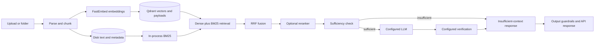

# Meridian

Meridian is a document question-answering service. It parses supported files, indexes them in Qdrant, combines dense retrieval with local BM25 using reciprocal-rank fusion, checks whether the retrieved context is sufficient, and sends supported questions to a configured language model. The FastAPI app also exposes document, retrieval, health, settings, and review endpoints.

## Architecture



Dense vectors are stored in Qdrant; disk records retain chunk text and metadata for ingestion state and BM25. Neo4j graph storage/context is optional and disabled by default. LiteLLM is an optional provider gateway; direct provider configuration is also supported.

## Five-minute local start

Requirements: Python 3.11+, `uv`, Node.js/npm for the web UI, and Docker for Qdrant. The first start downloads the configured embedding model if it is not cached.

1. Install dependencies and start the default Qdrant service:

   ```sh
   make setup
   make up
   ```

2. Configure `.env` with a local API key and an OpenAI-compatible provider. Replace the placeholders with your own values; do not commit this file.

   ```dotenv
   APP_ENV=development
   API_KEYS={"local-user-key":{"tenant":"default","role":"user"},"local-admin-key":{"tenant":"default","role":"admin"}}
   PROVIDER=custom
   BASE_URL=https://api.example.com/v1
   API_KEY=your-provider-key
   MODEL=your-model-name
   ```

   `PROVIDER`, `BASE_URL`, `API_KEY`, and `MODEL` are the generic provider settings. Alternatively, set provider-specific variables such as `OPENAI_API_KEY` and `OPENAI_BASE_URL` as supported by the configured provider.

3. Index the sample documents and run the isolated retrieval smoke check:

   ```sh
   make ingest DIR=sample_docs
   make retrieval-check
   ```

   The smoke check builds its own in-memory Qdrant index from `sample_docs`; it does not query the server index created by `make ingest`.

4. Start the API in another terminal and ask a question:

   ```sh
   ./start.sh --backend-only
   curl -sS http://localhost:8000/v1/query \
     -H 'Content-Type: application/json' \
     -H 'X-API-Key: local-user-key' \
     -d '{"query":"What vector database does Meridian use?","top_k":5}'
   ```

The complete UI and API startup options are in `./start.sh --help`. For troubleshooting and recovery commands, see [docs/RUNBOOK.md](docs/RUNBOOK.md).

## Current capabilities

| Status | Capability |
|---|---|
| Implemented | PDF, Markdown, text, DOCX, and HTML parsing; chunking; Qdrant indexing; local BM25; dense/BM25 fusion; retrieval endpoint; API-key tenant/role authentication; citations and verification modes. |
| Optional | Lexical or cross-encoder reranking (off by default); Langfuse export (disabled unless configured); Neo4j graph storage and graph context (both disabled by default); real-model DeepEval quality run (manual/scheduled). |
| Experimental | Human-review routes and ORM models. They are not connected to ingestion/query confidence decisions or correction-driven reindexing. |
| Not implemented | OCR for scanned PDFs, general semantic entailment verification, SSO, and streaming responses. |

Known limits: token counts are approximate; guardrails use lexical rules and do not provide general prompt-injection detection; BM25 indexes are in-process and rebuilt from the local corpus; per-process metrics/traces reset on restart. Local or private provider endpoints require the explicit `ALLOW_PRIVATE_PROVIDER_URLS=true` setting, except the Compose app's validated private bridge address for its named `litellm` service. Graph context remains experimental and disabled because the current small multi-hop evaluation showed no retrieval gain.

## Quality and development checks

The committed retrieval golden set has **50 cases**. The latest clean-checkout run passed with hit@5 **1.000**, MRR **0.873**, and unanswerable accuracy **1.000**. Across five isolated 5,000-point Qdrant server runs, median retrieval-only p95 was **13.1 ms** at one worker, **35.4 ms** at four, and **97.4 ms** at eight. The eight-worker p95 ranged from **88.2 to 105.3 ms** (two of five runs exceeded 100 ms); full request totals include query embedding and had median eight-worker p95 **128.4 ms**. See `docs/fix-log.md` for the run results and limitations.

Run the local checks with:

```sh
make test
make eval
uv run ruff check .
uv run mypy --explicit-package-bases packages services evals --ignore-missing-imports
npm --prefix web run test:run
npm --prefix web run build
```

`make eval` evaluates the 50-case retrieval set. `uv run python evals/eval_generation.py` runs the optional real-model generation/judge evaluation when its separate provider and judge settings are configured; it is not part of the default offline test suite.

## API examples

`POST /v1/retrieve` returns ranked chunks and retrieval timings without generation. `POST /v1/query` runs retrieval, sufficiency, generation, and verification. Both require `X-API-Key`.

```sh
curl -sS http://localhost:8000/v1/retrieve \
  -H 'Content-Type: application/json' -H 'X-API-Key: local-user-key' \
  -d '{"query":"What vector database does Meridian use?","top_k":5}'
```

`GET /health/live` is the process liveness endpoint. `GET /health/ready` reports basic service readiness; authenticated index details are available from the index-status endpoint. `GET /health` returns a minimal public service response.
